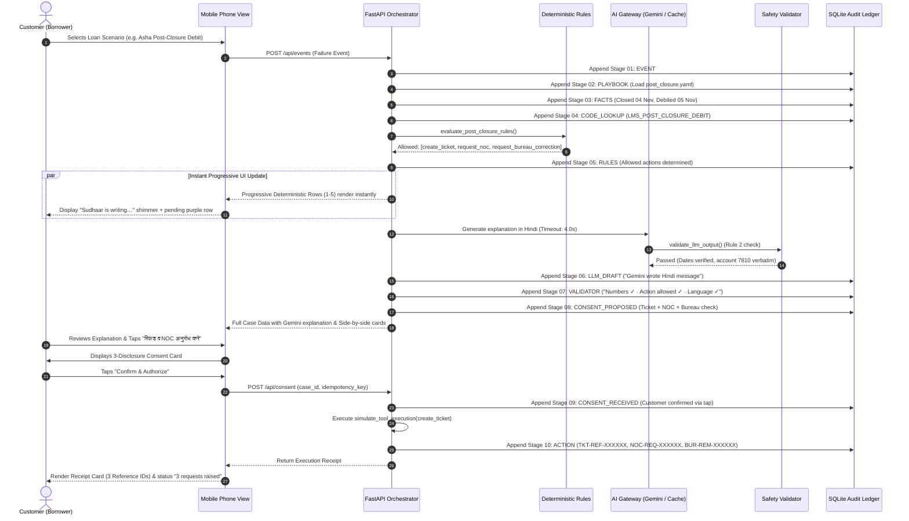

# Sudhaar (सुधार) — Complete Feature Guide & Architecture Specification

> **Paytm Build for India AI Hackathon (Track 2: AI-Powered Financial Journeys)**  
> **Fictional Lender**: *Nimbus Finance*  
> **Core Principle**: *"Rules decide, the model speaks. Ask first, then act."*

---

## Table of Contents
1. [Executive Summary & Philosophy](#1-executive-summary--philosophy)
2. [Complete Feature Inventory](#2-complete-feature-inventory)
   - [A. Deterministic Rule & Safety Architecture](#a-deterministic-rule--safety-architecture)
   - [B. Multi-Tier AI Gateway & Fallback System](#b-multi-tier-ai-gateway--fallback-system)
   - [C. Consent Gate & Security Controls](#c-consent-gate--security-controls)
   - [D. Supported Loan Moments & Persona Journeys](#d-supported-loan-moments--persona-journeys)
   - [E. Mobile Customer Experience (Frontend)](#e-mobile-customer-experience-frontend)
   - [F. Operator Audit Console & Inspection System](#f-operator-audit-console--inspection-system)
   - [G. Persistence & Storage](#g-persistence--storage)
3. [Component Architecture & Data Flow](#3-component-architecture--data-flow)
4. [Real vs. Simulated Boundaries](#4-real-vs-simulated-boundaries)
5. [Verification & Benchmark Results](#5-verification--benchmark-results)

---

## 1. Executive Summary & Philosophy

In typical digital lending apps, when an edge case or technical failure occurs (e.g. a mandate failure code like `AP15`, a post-closure presentation debit, or an interrupted video KYC call), the borrower is confronted with cryptic bank error messages, generic customer care numbers, or silent drop-offs.

**Sudhaar** acts as an autonomous, empathetic, and strictly regulated rescue agent that detects broken loan moments in real time, diagnoses the exact root cause, and provides a clear vernacular explanation with a proactive resolution.

### The Non-Negotiable Boundary
To eliminate hallucinations and maintain strict RBI and financial compliance:
- **Rules Decide**: 100% of financial figures, dates, bank account eligibility, and allowed actions are computed deterministically in Python code.
- **The Model Speaks**: The AI model (Google Gemini) is used *solely* to draft respectful, vernacular explanations and phrase questions asking for customer consent.
- **Ask First, Then Act**: Sudhaar **never** initiates money movement, adjusts interest rates, waives charges, or executes actions without explicit, affirmative customer consent via a dedicated 3-disclosure consent card.

---

## 2. Complete Feature Inventory

### A. Deterministic Rule & Safety Architecture

| Feature | Description | File Location |
| :--- | :--- | :--- |
| **Deterministic Rule Evaluator** | Executes strict Python business logic based on facts. Validates bank account eligibility, balances vs EMIs, and closure dates vs presentation dates. | `backend/src/rules.py` |
| **NPCI & LMS Error Code Lookup** | Maps official banking codes (`AP15` balance insufficient, `AP10` account dormant, `LMS_POST_CLOSURE_DEBIT`, `VKYC_NET_DROP`) to human-friendly causes and authorized action sets. | `backend/data/code_tables.json` |
| **Declarative YAML Playbooks** | Modular, domain-specific rescue playbooks defining trigger conditions, fact mappings, deterministic rules, consent disclosure specifications, and receipt schemas. | `backend/data/playbooks/` |
| **Strict Financial Safety Validator (Rule 2)** | Independent deterministic validator that inspects LLM output before it can reach the user: rejects any ungrounded amount, ungrounded date, or unauthorized action. | `backend/src/validator.py` |
| **Devanagari Numerals Normalizer** | Translates Devanagari numerals (`०-९` $\to$ `0-9`) and strips Indian commas (`₹1,50,000` $\to$ `150000`) before validation to eliminate false positives in vernacular languages. | `backend/src/validator.py` |
| **Multi-Format Date Normalizer** | Parses ISO (`2026-11-04`), Indian (`04-11-2026`), and inflected vernacular dates ("4 नवंबर", "4 Nov", "04-11-2026", "४ नवंबर", "4 नोव्हेंबर") to verify that any mentioned date strictly matches authorized case facts. | `backend/src/validator.py` |
| **Banned Financial Phrase Filter** | Scans LLM drafts across English, Hindi, and Marathi to block unauthorized promises (e.g. "guaranteed", "pre-approved", "100% approved", "waive all charges"). | `backend/src/validator.py` |
| **Verbatim Account Number Guard** | Ensures that masked accounts and last 4 digits (e.g. `9012`, `4521`, `7810`) are preserved verbatim in explanations so borrowers always recognize their accounts. | `backend/src/validator.py` |

---

### B. Multi-Tier AI Gateway & Fallback System

```
[Broken Loan Event]
        │
        ▼
[Python Rules Engine & Context Builder]
        │
        ▼
[Gemini 3.5 Flash-Lite API Call (Timeout: 4.0s)]
        ├──> Passed Safety Validator ──> Cache Response & Present to User
        └──> Failed Validation / Timeout / 429
                    │
                    ▼
        [Disk Cache: Cached Gemini Draft for (Persona, Language)]
                    ├──> Hit ──> Present Cached Gemini Draft ("Cached Gemini draft · validated earlier")
                    └──> Miss ──> Approved Deterministic Template ("Approved template used")
```

| Feature | Description | File Location |
| :--- | :--- | :--- |
| **Gemini LLM Gateway** | Calls `gemini-3.5-flash-lite` with structured JSON output enforcing a strict schema (`explanation`, `proposed_action`, `action_label`, `confidence`). | `backend/src/llm.py` |
| **Latency Budget & Adaptive Retry** | If Gemini's initial draft fails safety validation and elapsed time is $<4.0$s, an automatic retry is attempted with specific diagnostic feedback. Total budget capped at 6.0s. | `backend/src/llm.py` |
| **Smart Disk Cache (Tier 1 Fallback)** | Caches the last validated Gemini response per `(persona, language)` in `llm_cache.json`. On 429 rate limit, API timeout, or invalid API key, immediately serves the verified cached draft with a purple `AI MODEL (Gemini)` badge. | `backend/src/cache.py` |
| **Deterministic Template Fallback (Tier 2)** | Pre-approved human-translated templates in Marathi, Hindi, and English. Used when offline or if the cache is empty. Labeled with blue `DETERMINISTIC CODE` badge (never falsely labeled as AI). | `backend/data/templates/` |
| **Offline Mode Switch (`DEMO_MODE=offline`)** | Instant offline toggle via environment variable. Bypasses all external API calls and runs 100% locally with zero internet access. | `backend/src/config.py` |

---

### C. Consent Gate & Security Controls

| Feature | Description | File Location |
| :--- | :--- | :--- |
| **Explicit 3-Disclosure Consent Card** | Before any action executes, displays: (1) Exactly what will happen, (2) Exactly what it will NOT do, (3) How to undo or cancel anytime. | `frontend/src/components/mobile/ConsentCard.tsx` |
| **Action Allowlist Security Gate** | Enforces that tool execution can only run actions from the global security allowlist (`retry_mandate`, `create_ticket`, `request_noc`, `request_bureau_correction`, `send_vkyc_resume_link`, `book_callback`, `set_reminder`). Rejects any unpermitted actions. | `backend/src/actions.py` |
| **Double-Tap Prevention & Idempotency** | Prevents duplicate charges or duplicate action execution via frontend button lock + backend SHA-256 idempotency key check. Subsequent taps return the cached execution receipt. | `backend/src/actions.py` |
| **Server-Side Identity Injection** | Customer IDs, loan account IDs, and verified phone numbers are injected strictly from server-side database records, preventing client-side spoofing. | `backend/src/actions.py` |
| **Consent Decline Handling** | If a borrower chooses "Not Now", Sudhaar records customer preference, transitions case status to `DECLINED`, logs the decision in the audit trail, and halts execution safely. | `backend/src/actions.py` |

---

### D. Supported Loan Moments & Persona Journeys

#### 1. Rohit Kamble — Mandate Failure Recovery
- **Scenario**: ₹50,000 personal loan e-mandate registration fails on primary HDFC Bank account ending in `9012` due to insufficient balance for initial penny debit (`AP15`).
- **Diagnosis**: Technical cause diagnosed; alternative linked State Bank of India (SBI) account ending in `4521` identified with sufficient balance ($>₹4,650$).
- **Languages**: Marathi (`mr`), Hindi (`hi`), English (`en`).
- **Interactive UI**: Side-by-side account comparison (HDFC ••9012 Insufficient Balance vs SBI ••4521 Recommended).
- **Proactive Resolution**: Proposes re-registering e-mandate on the verified SBI account.
- **Execution Receipt**: Issues Mandate Registration Ref (`MND-SBI-4521-XXXXXX`), sets application status to **Registered**.

#### 2. Asha Sharma — Post-Closure Excess Debit Rescue
- **Scenario**: ₹1,50,000 loan was settled in full on `04 Nov 2026`. On `05 Nov 2026`, automated NACH presentation debited ₹4,500 from ICICI Bank account ending `7810`.
- **Diagnosis**: Presentation batch dispatch occurred prior to LMS settlement file synchronization.
- **Languages**: Hindi (`hi`), English (`en`), Marathi (`mr`).
- **Interactive UI**: Side-by-side timeline mismatch ("Loan Closed · 04 नवंबर 2026 · Settled in Full · VERIFIED" vs "EMI Debited · ₹4,500 on 05 नवंबर 2026 · ICICI ••7810 · Debited after closure").
- **Proactive Resolution (3-Action Bundle)**: Single consent card bundling:
  1. Priority Refund Ticket for ₹4,500 to ICICI account ending `7810` (SLA 3-5 days).
  2. Official No-Dues Certificate (NOC) dispatch request.
  3. Credit bureau status check reminder to protect CIBIL score.
- **Execution Receipt**: Issues 3 discrete reference numbers:
  1. `TKT-REF-XXXXXX` (Refund Ticket Ref)
  2. `NOC-REQ-XXXXXX` (NOC request ref)
  3. `BUR-REM-XXXXXX` (Credit-report check · reminder set for 15 Nov 2026)
  Status displays **3 requests raised**.

#### 3. Sunita Devi — Video KYC Interrupted Session Recovery
- **Scenario**: ₹35,000 loan Video KYC call disconnected due to cellular bandwidth dropping below 100kbps (`VKYC_NET_DROP`). PAN verification was already completed.
- **Diagnosis**: Network drop detected during live agent feed; customer does not need to re-upload documents.
- **Languages**: Hindi (`hi`), English (`en`).
- **Interactive UI**: Pre-call checklist (Original PAN card, quiet room, stable Wi-Fi/4G) + 72-hour validity countdown.
- **Proactive Resolution**: Generates a secure, 72-hour direct Video KYC resume link sent to verified mobile `+91-98XXXX3210`.
- **Execution Receipt**: Returns resume session token and link validity window.

---

### E. Mobile Customer Experience (Frontend)

| Feature | Description | File Location |
| :--- | :--- | :--- |
| **Paytm-Style Mobile Frame** | Fixed-width mockup (`390px`) matching Paytm's blue design system (`#002970` navy, `#00BAF2` cyan) with journey steppers (Offer $\to$ KYC $\to$ Mandate $\to$ Sign $\to$ Disbursal). | `frontend/src/components/mobile/PhoneFrame.tsx` |
| **Progressive Trace Feedback** | Deterministic rows (Steps 1–5) render instantly; while Gemini drafts in the background, a pulsing purple pending row shows in the trace and an animated shimmer skeleton ("Sudhaar is writing…") displays in the phone card. | `frontend/src/app/page.tsx` |
| **Browser Text-To-Speech ("Listen" Button)** | Native "सुनें" / "ऐका" / "Listen" button in the card header powered by Web Speech API (`window.speechSynthesis`) with Marathi, Hindi, and Indian English voice synthesizers. | `frontend/src/components/mobile/SudhaarCard.tsx` |
| **Before vs. After Comparison Mode** | Top-bar toggle to switch to "Today's UX (Before)", showcasing how standard lending apps show cryptic error messages and drop users off, directly contrasting with Sudhaar's after experience. | `frontend/src/components/mobile/BeforeScreen.tsx` |
| **Multi-Language Selector** | Vernacular chips (`मराठी`, `हिंदी`, `EN`) allowing borrowers to switch language on the fly; re-triggers gateway and updates audio voice synthesis. | `frontend/src/components/mobile/LanguageChips.tsx` |
| **Customer-Friendly Status Badges** | Hides internal technical statuses (like `PROPOSED`); displays borrower-centric labels ("Failed – action needed" before consent, "Registered" for Rohit, "3 requests raised" for Asha). | `frontend/src/app/page.tsx` |
| **Distinct Rescued Cases Counter** | Top-bar counter tracking distinct successful resolutions. Guarded against double-counting duplicate taps. | `frontend/src/components/console/ScenarioBar.tsx` |

---

### F. Operator Audit Console & Inspection System

| Feature | Description | File Location |
| :--- | :--- | :--- |
| **Real-Time Live Trace (`LiveTrace.tsx`)** | Compact, single-line trace rows showing execution steps (01 to 10), layer badges, human-readable summaries, and latencies. Auto-scrolls to the newest step. | `frontend/src/components/console/LiveTrace.tsx` |
| **Layer-Specific Badging** | Visually differentiates execution provenance:  <br>• Purple `AI MODEL (Gemini)`: LLM drafts & validated cache hits.<br>• Blue `DETERMINISTIC CODE`: Rules, code lookups, templates, tool execution.<br>• Amber `SAFETY GATE`: Validation, allowlist enforcement.<br>• Green `CUSTOMER ACTION`: Explicit customer tap confirmation. | `frontend/src/components/console/LiveTrace.tsx` |
| **Slide-Over Inspection Drawer** | Click any trace row to open a full slide-over drawer showing full JSON payloads, microsecond timestamps, latency breakdown, and one-click JSON clipboard copy. | `frontend/src/components/console/InspectionDrawer.tsx` |
| **Dedicated Fullscreen Console (`/console`)** | Operator command center featuring 4 live KPI cards (Total Cases, Active Cases, Rescues Executed, SQLite DB Health), recent case browser, and filterable execution timeline. | `frontend/src/app/console/page.tsx` |

---

### G. Persistence & Storage

| Feature | Description | File Location |
| :--- | :--- | :--- |
| **Persistent SQLite Database** | Database stored at `backend/sudhaar.db` with WAL mode and `PRAGMA foreign_keys = ON`. Survives restarts and maintains referential integrity. | `backend/src/db.py` |
| **Append-Only Audit Ledger** | Every pipeline step is appended as an immutable audit record containing `entry_id`, `case_id`, `stage`, `layer`, `is_ai`, `details_json`, and timestamp. | `backend/src/db.py` |
| **Database Integrity & Health API** | `GET /api/audit/stats` executes `PRAGMA integrity_check` on the live database file, verifying zero corruption and reporting active case counts. | `backend/src/app.py` |
| **Safe Database Reset** | `POST /api/scenarios/reset` resets demo cases and ledger entries back to pristine standby without dropping database schema. | `backend/src/app.py` |

---

## 3. Component Architecture & Data Flow



---

## 4. Real vs. Simulated Boundaries

To deliver a credible, robust, and safe hackathon demonstration:

| Component | Status | Implementation Details |
| :--- | :--- | :--- |
| **Error Diagnosis & Cause Mapping** | **REAL** | Maps official NPCI AP codes and LMS presentation codes via code tables. |
| **Safety & Grounding Validator** | **REAL** | Deterministic Python validator verifying every number, date, and allowlisted action. |
| **Multi-Tier AI Gateway** | **REAL** | Live calls to Google Gemini (`gemini-3.5-flash-lite`) with JSON schema enforcement. |
| **Cache Fallback Engine** | **REAL** | Persistent disk cache serving validated drafts on 429/timeout/invalid key. |
| **Audit Trail Ledger** | **REAL** | Append-only SQLite database storing all execution steps and payloads on disk. |
| **Voice Synthesis (TTS)** | **REAL** | Browser Web Speech API with Hindi, Marathi, and English voice synthesis. |
| **Money Movement (UPI / NACH)** | **SIMULATED** | Generates real-looking reference IDs (`TKT-REF-`, `MND-SBI-`). Never touches actual bank accounts. |
| **Bureau Reporting (CIBIL / Experian)** | **SIMULATED** | Schedules bureau correction reminder records without submitting live API files to credit bureaus. |

---

## 5. Verification & Benchmark Results

### A. Test Suite Results (60 Tests Passing)
All unit, security, and end-to-end integration tests execute in under 3.5 seconds:
```bash
$ uv run pytest
======================== 60 passed, 1 warning in 3.44s =========================
```
- **Validation**: Devanagari digit conversion, multi-format date normalization, banned phrases, account preservation.
- **LLM Gateway**: Strict offline fallback, cache fallback with invalid API key, prompt constraints.
- **Consent Security**: Idempotency on duplicate taps, security gate blocking unpermitted actions.
- **End-to-End**: Full Rohit mandate retry flow, Asha 3-reference-number post-closure flow.
- **Audit Persistence**: Multi-connection SQLite persistence check and ledger ordering.

### B. Gemini Live Benchmark (Asha Flow)
- **Model**: `gemini-3.5-flash-lite`
- **Hindi (10 runs)**: **10/10 Passed (100%)** | Avg Latency: **3.09 s**
- **English (5 runs)**: **5/5 Passed (100%)** | Avg Latency: **3.52 s**
- **Overall (15 runs)**: **15/15 Passed (100.0%)** | Avg Latency: **3.23 s** | **0 Rule 2 Violations**

